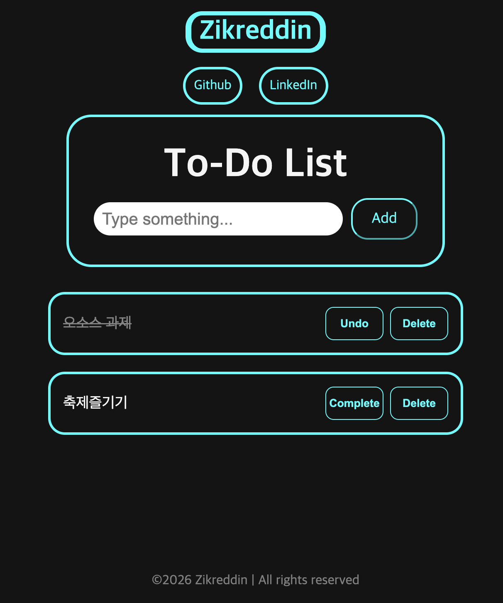
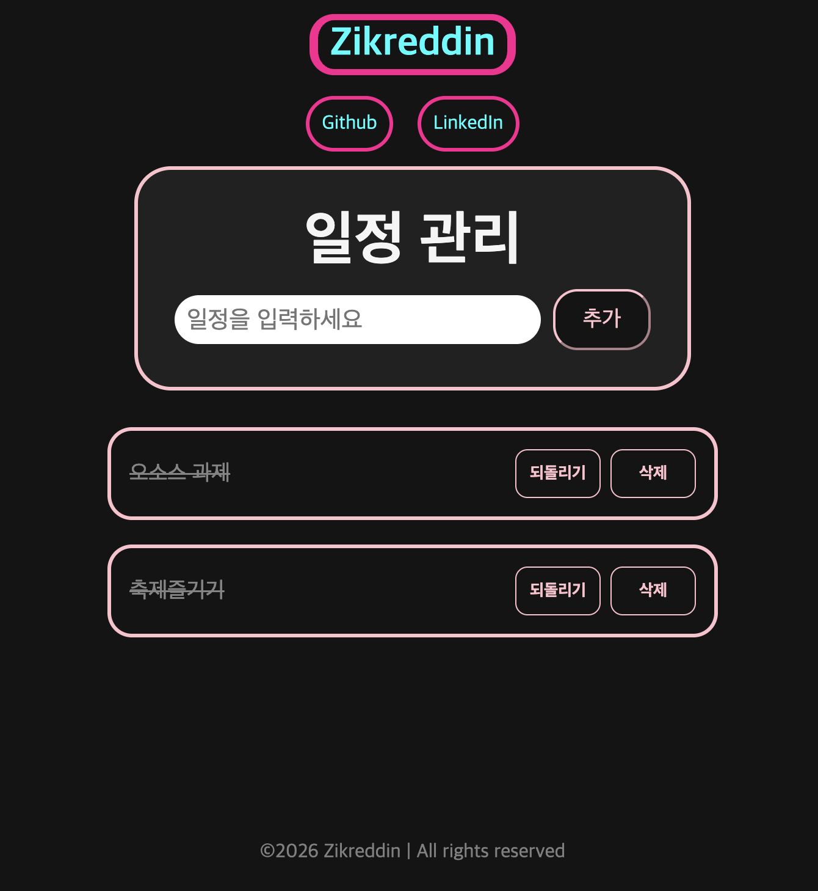
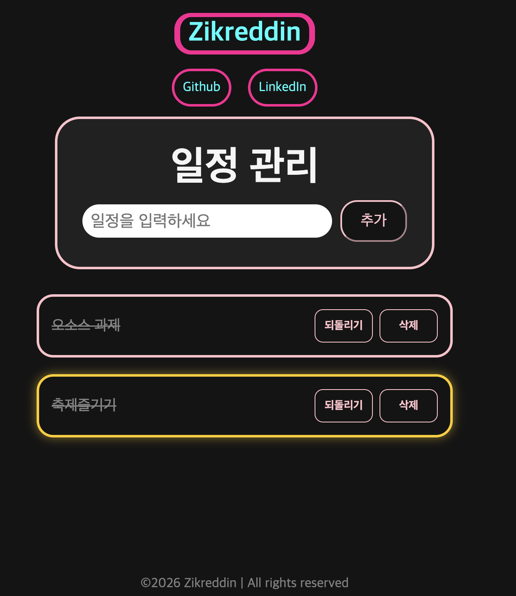

## 프로젝트 소개
React를 이용한 간단한 TODO LIST 프로그램입니다.
할 일을 작성하고, COMPLETE와 UNDO 기능이 있으며, 다 한 일정은 DELETE로 삭제할 수 있습니다.

## 선택이유
react를 처음 다루기 때문에 기능이 지나치게 많은 프로그램은 피하려고 했습니다. 지금껏 주로 개발해온 프로젝트가 CRUD 기능이기 때문에, CRUD 기능을 가지고 있는 TODOLIST를 고르게 되었습니다. 

## 원본 URL
- https://github.com/zikreddincikla/react-todo

## 원본 라이선스 
MIT License Copyright (c) 2026 Zikreddin

## 배포 URL 
- https://react-todo-drab-eight.vercel.app/

## Installation
```bash
git clone https://github.com/zikreddincikla/react-todo.git
cd react-todo
npm install
npm run dev
```

## 실행화면


## Project Structure
1. Todo.jsx : 사용자가 일정을 입력하여 App.jsx가 정보를 제공하면, 해당 객체를 화면에 띄우는 함수 파일
2. App.css : 프로그램의 디자인 css를 작성한 파일
3. App.jsx : 프로그램의 중심 파일로, 특히 새로고침을 하더라도 목록이 남아있게 하기 위해 목록을 localStorage에 저장하는 기능이 존재한다.

## React 컴포넌트
1. App : 프로그램 전체를 조립하는 컴포넌트로, TODO 목록을 화면에 띄우고 각 일정의 추가, 삭제에 따른 목록을 변경현다. 
2. Todo : 각 일정의 이름과 상태, 버튼 함수를 넘겨받아 실행한다.

## 코드분석
```jsx
function Todo({ id, todo, onToggle, onDelete }) {
  return (
    <li id='todo-item'>
      <p 
        style={{ 
          textDecoration: todo.completed ? 'line-through' : 'none', 
          opacity: todo.completed ? '0.5' : '1'
        }} 
        className='todo-p'
      >
        {todo.text}
      </p>
      <div className='buttons'>
        <button type='button' onClick={() => onToggle(id)}> 
          {todo.completed ? 'Undo' : 'Complete'} 
        </button>
        <button type='button' onClick={() => onDelete(id)}>Delete</button>
      </div>
    </li>
  );
}

export default Todo; 
```

id와 todo 객체, onToggle, onDelete를 받아 상태를 표시하는 코드이다.
todo 객체의 상태에 따라 삼항연산자로 해당 객체의 출력 형식을 취소선, 투명도, 버튼 문구를 설정한다. onToggle(id)과 onDelete(id)를 통해 클릭될 때 todo.completed 값을 설정하거나 삭제하는 함수를 실행힌다.


## 수정한 부분
1. App.css에서 전반적인 디자인 계열을 aqua - > pink 계열로 수정
2. 프로그램의 언어를 영어에서 한국어로 수정
3. 일정을 클릭할 시 강조되도록 기능 추가


- 변경 이후 디자인 


- 강조 기능

## weekly review

### 새롭게 배운 내용
1. useState로 상태 관리하는 법을 배웠다. setTodos로 목록이 바뀔 때마다 react가 화면을 다시 그리게 된다.
2. JSX를 이용하여 자바스크립트 내에서 <form> <button> <Todo />처럼 화면 구조를 작성할 수 있음을 배웠다.
3. App, Todo, Header, Footer 컴포넌트로 분리하여 기능을 분리할 수 있음을 배웠다. App은 목록 데이터와 전체 흐름 관리, Todo는 일정 한 개의 객체를 담당한다.

### 어려웠던 점과 해결 방법
직접 짠 코드가 아닌 타인이 짠 코드를 이해하는 과정이 조금 어려웠다. react 자체가 익숙치 않은 문법 구조인 것과 더하여 처음 보는 프로그램의 전체 소스를 천천히 이해해보면서 어떤 구조로 프로그램이 작성되어 있고, react의 어떤 기능을 사용하였는지 확인하는 과정이 어려웠다.
이번에는 AI의 도움을 최소한으로 하여 직접 코드를 이해해보았는데, 프로그램의 구조가 머릿속에 그려지는 느낌이 들어 재미있었다.

### AI 활용
프로그램 소스코드를 이해해보면서 왜 이런 구조로 설계했는지 의도를 파악할 때 주로 이용하였다. 왜 Todo를 분리하여 설계했는지 등을 물어보았다.

